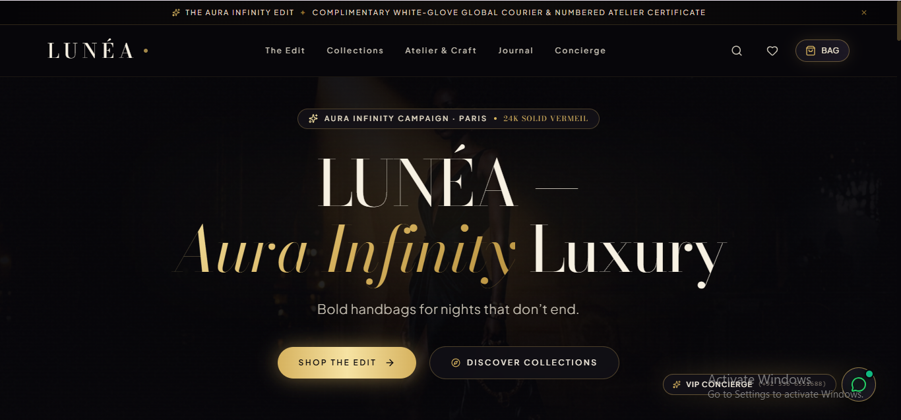
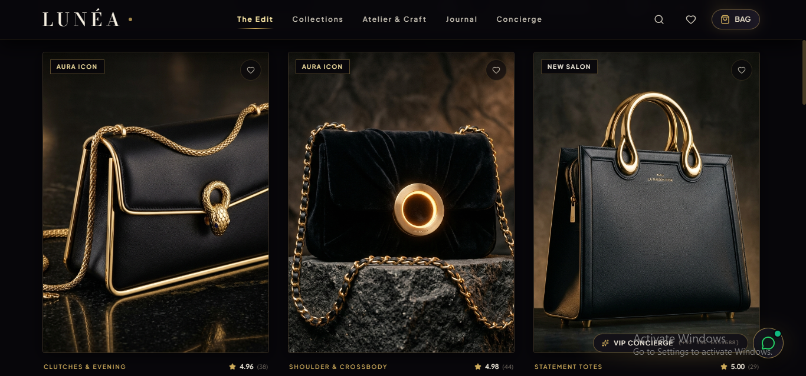
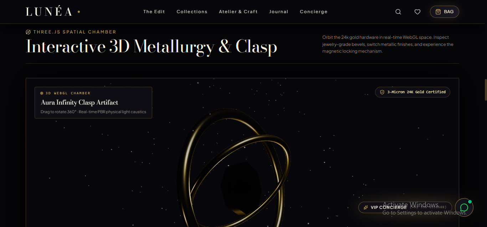
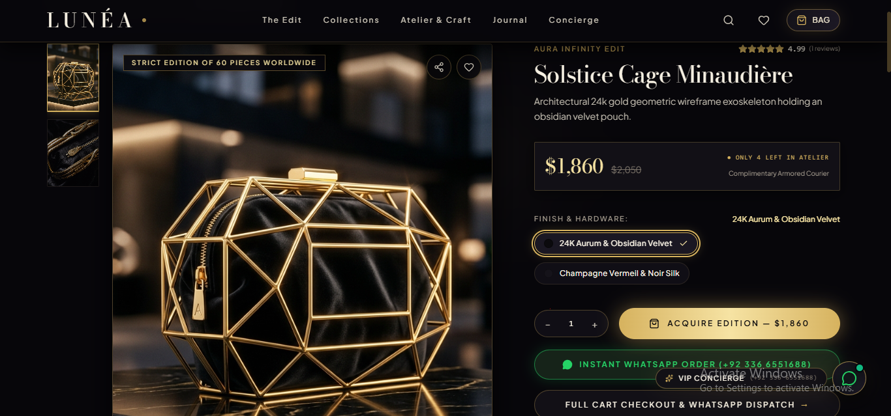
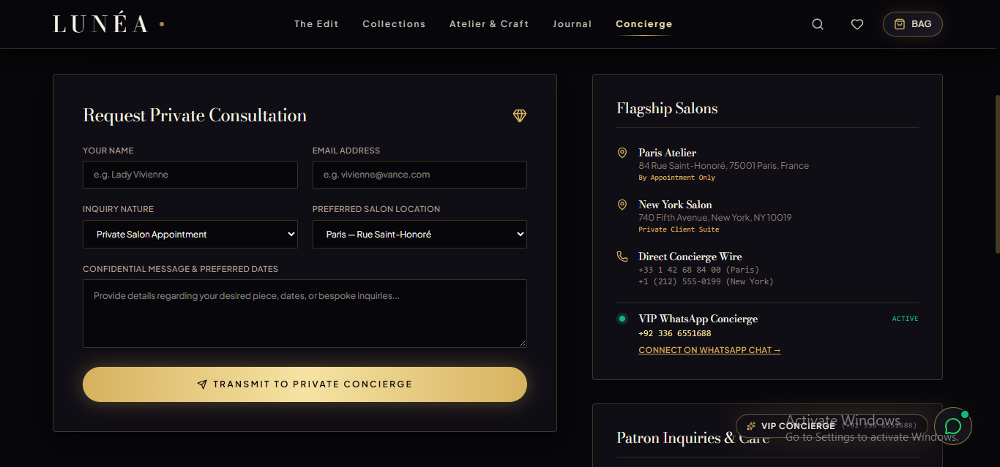

# LUNÉA — Luxury Handbags

An immersive luxury e-commerce experience inspired by Parisian haute maroquinerie, featuring curated handbag collections, interactive 3D hardware visuals, WhatsApp order dispatch, and private-client concierge services.

**Live Website:** [lunea-luxury-handbags.vercel.app](https://lunea-luxury-handbags.vercel.app/)

**GitHub Repository:** [MahamYasir-ai/lunea-luxury-handbags](https://github.com/MahamYasir-ai/lunea-luxury-handbags)

---

## Overview

LUNÉA is a luxury handbag storefront built around a distinctive noir-and-gold visual identity. Inspired by Parisian craftsmanship and exclusive atelier collections, the website combines editorial brand storytelling with interactive product presentation and customer-focused shopping features.

Rather than following a conventional e-commerce layout, LUNÉA presents its products through immersive collection showcases, detailed craftsmanship sections, interactive 3D visuals, and personalized customer service experiences.

The platform also incorporates WhatsApp-based order coordination and private salon consultation requests, connecting the digital storefront with direct customer communication.

## Screenshots

### Homepage

The main storefront introduces the LUNÉA brand through its signature Aura Infinity aesthetic, luxury editorial styling, and featured collections.



### Signature Collections

Explore curated handbag collections featuring sculptural silhouettes, evening bags, statement totes, and limited-edition designs.



### Interactive 3D Showcase

A Three.js-powered spatial experience presents featured hardware and metallic finishes through interactive 3D visuals.



### WhatsApp Order Dispatch

Customers can connect with the business through WhatsApp to discuss products, coordinate orders, and continue their purchase enquiries.



### Private Salon Experience

A dedicated private-client section introduces personalized consultations, bespoke enquiries, and VIP concierge contact options.



---

## Key Features

### Luxury E-Commerce Experience

- Premium noir-and-gold visual identity.
- Editorial layouts and immersive product storytelling.
- Curated collection browsing and product discovery.
- Dedicated sections for craftsmanship, brand identity, and private-client services.
- Responsive interface for modern desktop and mobile screens.

### Curated Handbag Collections

The storefront presents several signature design universes:

**Aura Infinity Edit**

The flagship collection, centered on luminous gold-inspired hardware, sculptural forms, and the brand's signature aesthetic.

**Sovereign Noir**

Architectural silhouettes and bold, understated designs inspired by modern evening luxury.

**Nocturne Vermeil**

Evening-inspired pieces featuring warm metallic accents, rich textures, and refined styling.

The wider collection experience includes clutches, shoulder bags, crossbody designs, statement totes, and limited atelier editions.

### Interactive 3D Product Showcase

The Three.js spatial chamber provides an interactive way to explore featured hardware and product details.

- Interactive 3D presentation.
- Exploration of metallic finishes.
- Spatial product visualization.
- Motion and depth that enhance the product-viewing experience.

### WhatsApp Order Dispatch

The integrated WhatsApp flow provides a direct communication channel between customers and the business.

- Direct access to WhatsApp from the storefront.
- Product and order enquiries.
- Customer communication for order coordination.
- A convenient transition from browsing to direct contact.

### Private Salon Consultations

The private-client experience allows customers to request personalized consultations and enquire about exclusive collections and bespoke services.

- Private salon appointment requests.
- VIP concierge contact information.
- Personalized product enquiries.
- Dedicated sections for private-client experiences.

### Craftsmanship & Brand Storytelling

The website includes editorial content highlighting the design philosophy and craftsmanship behind the collections.

- Parisian atelier-inspired presentation.
- Leather and hardware storytelling.
- Collection-specific design narratives.
- Limited-edition and numbered-piece concepts.
- Brand-focused editorial sections.

### VIP Concierge & Newsletter

The storefront includes dedicated concierge contact information and an email sign-up section for private-client communications, collection announcements, and invitation-style brand updates.

Actual newsletter delivery depends on the email service and subscription handling configured for the deployment.

---

## Technology Stack

| Technology | Purpose |
|---|---|
| React | Component-based user interface |
| TypeScript | Typed application development |
| Tailwind CSS | Responsive styling and utility-based design |
| Framer Motion | Interface animations and transitions |
| Three.js | Interactive 3D product visuals |
| Vite | Development server and production build tooling |
| Vercel | Hosting and deployment |
| WhatsApp integration | Direct customer communication and order coordination |

The exact installed packages and versions are defined in the project's package configuration.

---

## Customer Journey

1. **Discover** — Enter the storefront and explore the LUNÉA brand identity.
2. **Browse** — Navigate signature collections and featured handbag designs.
3. **Explore** — Experience interactive product visuals and craftsmanship storytelling.
4. **Enquire** — Contact the business through the WhatsApp order-dispatch flow.
5. **Personalize** — Request a private salon consultation or contact the concierge.

This journey connects product discovery with direct customer interaction and personalized service.

---

## Project Highlights

- Luxury-focused interface design and visual consistency.
- Collection-based product discovery.
- Interactive 3D web visualization.
- WhatsApp-enabled order communication.
- Private-client consultation experience.
- Editorial storytelling for premium products.
- Responsive storefront development.
- Deployment through Vercel.

LUNÉA demonstrates how immersive design, product presentation, and direct communication can be combined in a branded e-commerce experience.

---

## Run Locally

### Prerequisites

- Node.js installed.
- npm or another package manager compatible with the repository.
- Git installed.

### 1. Clone the repository

```bash
git clone https://github.com/MahamYasir-ai/lunea-luxury-handbags.git
```

### 2. Open the project directory

```bash
cd lunea-luxury-handbags
```

### 3. Install dependencies

Using npm:

```bash
npm install
```

If the repository uses Bun or another package manager, follow the lockfile and scripts provided in the project.

### 4. Start the development server

```bash
npm run dev
```

Open the local URL printed in the terminal to view the website.

### 5. Build for production

```bash
npm run build
```

Use the scripts in `package.json` as the source of truth if the commands differ.

---

## Deployment

The project is deployed using Vercel.

**Live Demo:** [https://lunea-luxury-handbags.vercel.app/](https://lunea-luxury-handbags.vercel.app/)

The deployment provides a public-facing experience for exploring the storefront and its implemented features.

---

## Future Enhancements

Potential improvements for a production-ready e-commerce platform include:

- Secure checkout and payment processing.
- Inventory management and order tracking.
- Customer accounts and saved products.
- Automated order notifications.
- Backend-powered newsletter subscriptions.
- Verified NFC authentication and certificate lookup.
- Integrated appointment scheduling.
- Analytics and customer engagement reporting.

These are future enhancement ideas and should not be interpreted as currently implemented features.

---

## Developer

**Maham Yasir**

Electronics Engineering graduate building projects across AI applications, automation, and modern web development.

- **GitHub:** [MahamYasir-ai](https://github.com/MahamYasir-ai)
- **Project Repository:** [LUNÉA Luxury Handbags](https://github.com/MahamYasir-ai/lunea-luxury-handbags)
- **Live Website:** [LUNÉA](https://lunea-luxury-handbags.vercel.app/)

---

*LUNÉA — Haute maroquinerie for nights that don't end.*
